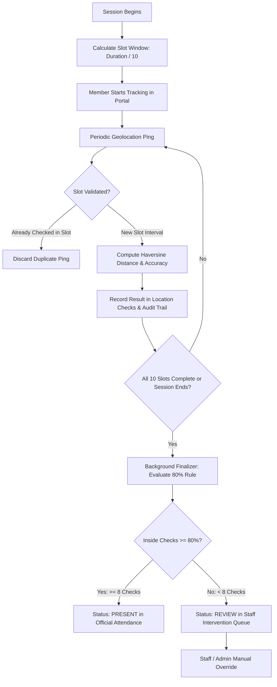
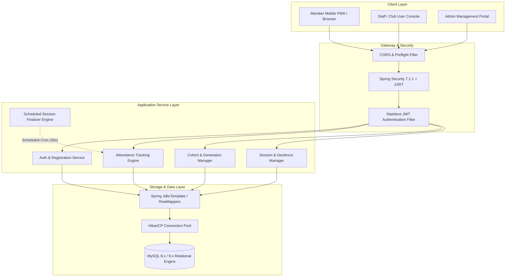
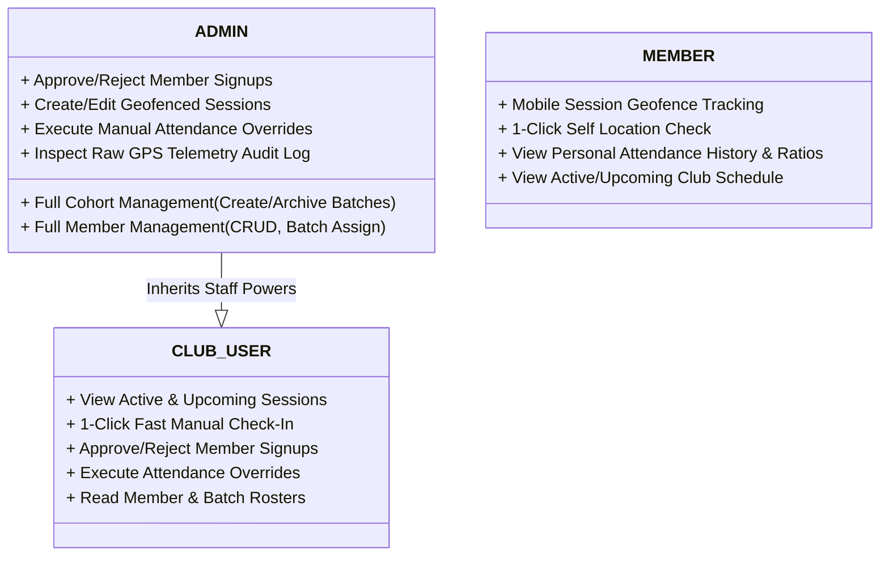
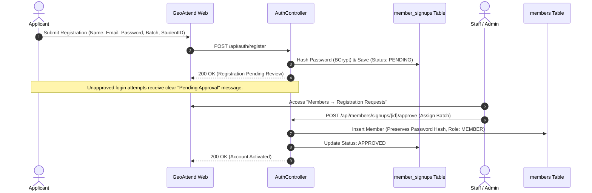
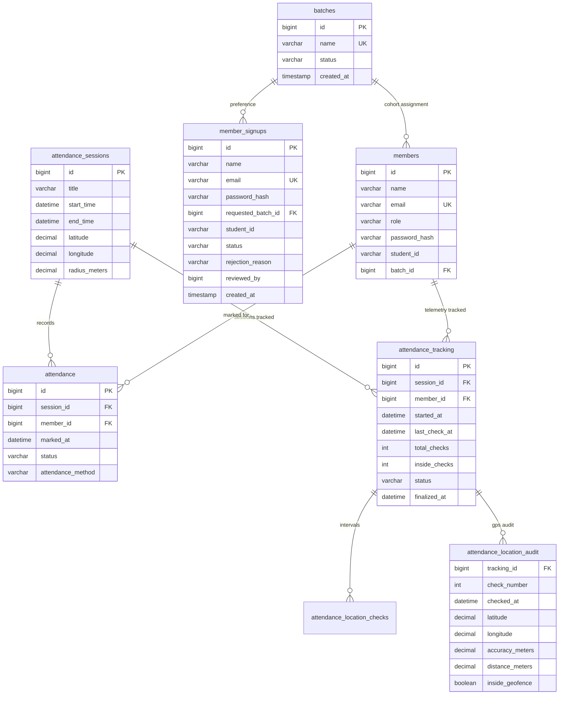

# GeoAttend — Automated Geofencing Attendance Management System

<div align="center">


-brightgreen)
-orange)

**Authoritative, real-time geofence tracking and multi-cohort attendance verification system designed for the Oyster Kode Club.**

[Architecture Blueprint](#system-architecture) •
[10-Slot Algorithm](#core-geofencing-engine--10-slot-algorithm) •
[Security & RBAC](#security--access-control-model) •
[API Specification](#restful-api-specification) •
[Getting Started](#getting-started--local-development)

</div>

---

## 1. Executive Summary & Problem Statement

Traditional attendance methods—such as manual paper sign-ins, verbal roll calls, and static QR codes—are vulnerable to proxy attendance, buddy punching, and location spoofing. 

**GeoAttend** eliminates physical roll calls and proxy marking by continuously verifying members' physical presence inside a designated geofenced perimeter for the active duration of club sessions.

### Key Capabilities
- **Continuous Telemetry Sampling**: Partitions sessions into a dynamic 10-slot sampling schedule rather than a single check-in event.
- **80% Presence Rule**: Requires participants to be physically verified inside the geofence across at least 80% of expected intervals to earn automated attendance.
- **GPS Drift Gating & Margin Protection**: Accounts for consumer GPS drift using reported hardware accuracy gating ($\pm \text{meters}$) and a capped boundary margin.
- **Native Registration Queue**: Email/password registration pipeline with administrative review and generation-based cohort assignment.
- **Role-Based Experience**: Customized workflows for **Members** (mobile-first tracking dashboard), **Club Staff** (fast 1-click check-ins and session monitoring), and **Administrators** (full cohort, geofence, and audit telemetry control).

---

## 2. Core Geofencing Engine & 10-Slot Algorithm

The tracking engine operates on a mathematically rigorous validation pipeline:

### 2.1 Spherical Haversine Perimeter Evaluation
When a client submits coordinates $(lat_m, lon_m)$ with reported accuracy $acc$ (meters), the backend calculates great-circle distance $d$ from the session center $(lat_s, lon_s)$:

$$\Delta lat = \text{radians}(lat_m - lat_s), \quad \Delta lon = \text{radians}(lon_m - lon_s)$$

$$a = \sin^2\left(\frac{\Delta lat}{2}\right) + \cos(\text{radians}(lat_s)) \cdot \cos(\text{radians}(lat_m)) \cdot \sin^2\left(\frac{\Delta lon}{2}\right)$$

$$c = 2 \cdot \text{atan2}\left(\sqrt{a}, \sqrt{1 - a}\right)$$

$$d = R \cdot c \quad (R = 6,371,000 \text{ meters})$$

### 2.2 Accuracy Gating & Boundary Buffer
- **Radius Check**: A point is inside if $d \le \text{radius} + \text{margin}$.
- **Capped Boundary Margin**: A deliberate $5.0\text{m}$ buffer accommodates minor multi-path reflections and mobile hardware sensor jitter without artificially expanding the venue perimeter.
- **Hardware Accuracy Tiers**:
  - `HIGH` ($acc \le 20\text{m}$): Immediate authoritative evaluation.
  - `ACCEPTABLE` ($20\text{m} < acc \le 50\text{m}$): Validated with boundary margin consideration.
  - `POOR` ($acc > 50\text{m}$): Logged with a degradation warning in the audit trail.

### 2.3 The 10-Interval Evaluation Pipeline



---

## 3. System Architecture

GeoAttend is structured as a decoupled, multi-tier system designed for transaction safety and high concurrent telemetry reads.



### Component Breakdown
| Component | Technology | Responsibility |
| :--- | :--- | :--- |
| **Frontend** | React 19, Vite 8.3, Vanilla CSS | Responsive client with Screen Wake Lock, Geolocation API, debounced query filters, and pagination toolbars. |
| **Backend** | Spring Boot 4.1.1, Java 21 LTS | REST API controllers, BCrypt hashing, JJWT token generation, and authoritative spatial calculations. |
| **Background Scheduler** | Spring `@Scheduled` (`30s` interval) | Automated evaluation of ended sessions, calculating presence ratios and updating tracking states. |
| **Database** | MySQL 8.x / 9.x | ACID-compliant storage with indexed foreign keys, unique constraint locks, and location audit trails. |

---

## 4. Security & Access Control Model

### 4.1 Role Hierarchy & Permissions (RBAC)



### 4.2 Member Registration & Approval Workflow
To prevent unauthorized users from registering self-elevated accounts or polluting active cohorts, registrations follow an administrative review lifecycle:



---

## 5. Database Schema & Data Dictionary

The persistence model guarantees referential integrity, historical preservation, and zero data leakage:



---

## 6. RESTful API Specification

### Authentication & Registration
| Method | Endpoint | Auth | Description |
| :--- | :--- | :--- | :--- |
| `POST` | `/api/auth/register` | Public | Submit new member registration request. |
| `POST` | `/api/auth/login` | Public | Authenticate staff or approved members; returns JWT. |

### Cohort & Batch Engine
| Method | Endpoint | Auth | Description |
| :--- | :--- | :--- | :--- |
| `GET` | `/api/batches` | Staff, Admin | List cohorts with optional status and search filtering (`page`, `size`). |
| `POST` | `/api/batches` | Admin | Create a new batch / generation cohort. |
| `PUT` | `/api/batches/{id}/status` | Admin | Toggle batch status between `ACTIVE` and `ARCHIVED`. |

### Member Directory & Review Queue
| Method | Endpoint | Auth | Description |
| :--- | :--- | :--- | :--- |
| `GET` | `/api/members` | Staff, Admin | Query members with multi-field search, batch filter, and pagination. |
| `POST` | `/api/members` | Admin | Manually onboard a member. |
| `PUT` | `/api/members/{id}/batch` | Staff, Admin | Assign or reassign a member to a generation cohort. |
| `GET` | `/api/members/signups` | Staff, Admin | Query pending/reviewed registration requests. |
| `POST` | `/api/members/signups/{id}/approve` | Staff, Admin | Approve registration and provision active member account. |
| `POST` | `/api/members/signups/{id}/reject` | Staff, Admin | Reject registration with optional reason note. |

### Sessions & Geofences
| Method | Endpoint | Auth | Description |
| :--- | :--- | :--- | :--- |
| `GET` | `/api/sessions` | All Roles | List upcoming, active, and completed sessions. |
| `POST` | `/api/sessions` | Admin | Create session with venue center coordinate and radius. |
| `PUT` | `/api/sessions/{id}` | Admin | Update session parameters or active geofence boundary. |
| `DELETE`| `/api/sessions/{id}` | Admin | Delete an upcoming or completed session. |

### Attendance & Telemetry
| Method | Endpoint | Auth | Description |
| :--- | :--- | :--- | :--- |
| `GET` | `/api/attendance` | Staff, Admin | Query authoritative attendance records with filters & pagination. |
| `POST` | `/api/attendance/manual` | Staff, Admin | 1-click manual attendance entry for active sessions. |
| `POST` | `/api/attendance/self` | Member | Record self-check from client location in an active session. |
| `POST` | `/api/attendance/tracking/start` | Member | Initiate 10-slot tracking lifecycle for a session. |
| `POST` | `/api/attendance/location-check` | Member | Submit periodic interval coordinates for geofence validation. |
| `GET` | `/api/attendance/session/{id}/checks` | Admin | Retrieve raw GPS coordinates, accuracy, and distances for audit. |
| `GET` | `/api/attendance/my` | Member | Retrieve authenticated member's personal attendance history. |

---

## 7. Frontend User Experience & Portals

The frontend is built with high aesthetic standards using modern, responsive styling:

### 7.1 Member Portal (`/member/home` & `/member/attendance`)
- **Status Banners & Timers**: Dynamic status indicators informing members whether a session is upcoming, live, or completed.
- **Visual 10-Slot Progress Tracker**: Animated step progress bar displaying verified intervals inside vs outside the geofence.
- **Screen Wake Lock & Diagnostics**: Integrates the Screen Wake Lock API to prevent mobile sleep during tracking sessions, providing live battery/timer diagnostics.
- **Attendance Analytics**: KPI stat cards displaying Total Sessions Attended, Overall Presence Rate, and Cohort Ranking.

### 7.2 Staff & Admin Console (`/dashboard`, `/members`, `/attendance`, `/batches`)
- **Live Active Session Hub**: Real-time progress indicators showing present members and cohort breakdown.
- **Fast Manual Check-In Modal**: Searchable instant check-in dialog allowing staff to mark students on-site in 1 click.
- **Intervention Review Queue**: Flagged cases below 80% with 1-click **Approve Override** functionality.
- **Authoritative GPS Audit Inspector**: Raw telemetry inspection showing timestamp, coordinates, device accuracy ($\pm\text{m}$), distance from center, and result.
- **Persistent Pagination Toolbar**: Standardized toolbar across all tables featuring record ranges (`Showing 1–10 of 14 records`), configurable rows-per-page (`10`, `20`, `50`), and numbered page controls.

---

## 8. Getting Started & Local Development

### 8.1 Prerequisites
- **JDK 21** or higher (`openjdk-21-jdk`)
- **Node.js 18+** & **npm**
- **MySQL 8.0+** running on `localhost:3306`

### 8.2 Database Setup
Create the MySQL database and user:

```sql
CREATE DATABASE geoattend CHARACTER SET utf8mb4 COLLATE utf8mb4_unicode_ci;
CREATE USER 'geoattend_user'@'localhost' IDENTIFIED BY 'GeoAttend@123';
GRANT ALL PRIVILEGES ON geoattend.* TO 'geoattend_user'@'localhost';
FLUSH PRIVILEGES;
```

> [!NOTE]
> Database tables, indexes, and schema updates are automatically applied on startup via `DatabaseSchemaInitializer.java` and `schema.sql`.

### 8.3 Backend Configuration & Launch
1. Verify configuration in `geo-attend-backend/src/main/resources/application.properties`:
   ```properties
   server.port=8081
   spring.datasource.url=jdbc:mysql://localhost:3306/geoattend
   spring.datasource.username=geoattend_user
   spring.datasource.password=GeoAttend@123
   jwt.secret=GeoAttendSuperSecretKeyForDevelopmentOnly123456789
   ```

2. Run the Spring Boot backend:
   ```bash
   cd geo-attend-backend
   ./mvnw spring-boot:run
   ```
   *The backend will boot up at `http://localhost:8081`.*

### 8.4 Frontend Installation & Launch
1. Install dependencies:
   ```bash
   cd geoattend-frontend
   npm install
   ```

2. Start the Vite development server:
   ```bash
   npm run dev
   ```
   *The client application will start at `http://localhost:5173`.*

---

## 9. Seed Credentials for Local Testing

| Role | Email | Password | Primary Workflow |
| :--- | :--- | :--- | :--- |
| **Administrator** | `admin@oysterkode.com` | `admin123` | Session geofence creation, registration review, cohort manager, raw GPS audit. |
| **Club Staff** | `clubuser@oysterkode.com` | `clubuser123` | Active session monitoring, 1-click fast manual check-in, review overrides. |
| **Club Member** | `test@geoattend.com` | `member123` | Mobile geofence tracking, live attendance progress bar, personal records. |

---

## 10. Automated Testing & Verification

The backend test suite verifies transaction safety, geofencing boundary mathematics, authorization barriers, and pagination logic:

```bash
# Execute backend test suite
cd geo-attend-backend
./mvnw clean test
```

### Verified Test Suites (63 Tests Passing)
- `GeolocationReliabilityAndBoundaryTest`: Haversine distance, boundary margin ($+5\text{m}$ buffer), accuracy degradation gating.
- `AttendanceTrackingServiceReliabilityTest`: 10-slot interval distribution, 80% threshold calculation, duplicate slot prevention.
- `RegistrationSecurityAndRestrictionTest`: Native email/password submission, duplicate prevention, password preservation.
- `RegistrationApprovalTest`: Approval into member roster, status transitions, batch preference assignment.
- `RoleAuthorizationIntegrationTest`: RBAC endpoint gates (ensures Members receive 403 Forbidden on staff endpoints).
- `FilterAndPaginationTest`: Dynamic search, cohort filters, date range boundaries, and `PagedResponse<T>` metadata.
- `BatchServiceTest` & `MemberBatchAssignmentTest`: Single-batch constraints and generation transitions.

```bash
# Execute frontend linter & production bundle
cd geoattend-frontend
npm run lint    # 0 errors
npm run build   # Compiled in ~400ms
```

---

## 11. Project Directory Structure

```text
Geo_Attendence/
├── README.md                                  # Root System Documentation
├── .gitignore                                 # Git configuration (ignoring build & local files)
├── geo-attend-backend/                        # Java 21 / Spring Boot 4 Backend
│   ├── pom.xml                                # Maven build specifications
│   └── src/
│       ├── main/
│       │   ├── java/com/geoattend/backend/
│       │   │   ├── config/                    # Security, CORS, Schema auto-initializer
│       │   │   ├── controller/                # REST endpoints (Auth, Members, Sessions, Batches, Attendance)
│       │   │   ├── model/                     # Domain entities, records, and DTOs
│       │   │   ├── repository/                # Spring JDBC queries & dynamic filters
│       │   │   ├── security/                  # JJWT service, filters, and user details
│       │   │   ├── service/                   # Geofencing policy, tracking & approval logic
│       │   │   └── util/                      # Date range & spatial utilities
│       │   └── resources/
│       │       ├── application.properties     # Connection & JWT properties
│       │       └── schema.sql                 # Table DDL & database indices
│       └── test/                              # Comprehensive JUnit 5 integration tests
└── geoattend-frontend/                        # React 19 / Vite 8.3 Frontend
    ├── package.json                           # Dependencies & scripts
    ├── vite.config.js                         # Bundler configuration & dev server proxy
    ├── src/
    │   ├── components/                        # UI components (Pagination, Table, Modals, StatCards)
    │   ├── hooks/                             # Custom React hooks (useDebounce, etc.)
    │   ├── pages/                             # Portals (Dashboard, Members, Attendance, Sessions, Batches)
    │   ├── services/                          # Typed API client services
    │   ├── App.css                            # Unified Oyster Kode Club design system
    │   ├── App.jsx                            # Router configuration & protected auth routes
    │   └── main.jsx                           # Application entry point
    └── public/                                # Favicons & club branding assets
```

---

<div align="center">
<b>Oyster Kode Club</b> • Building technology that powers precision and community.
</div>
